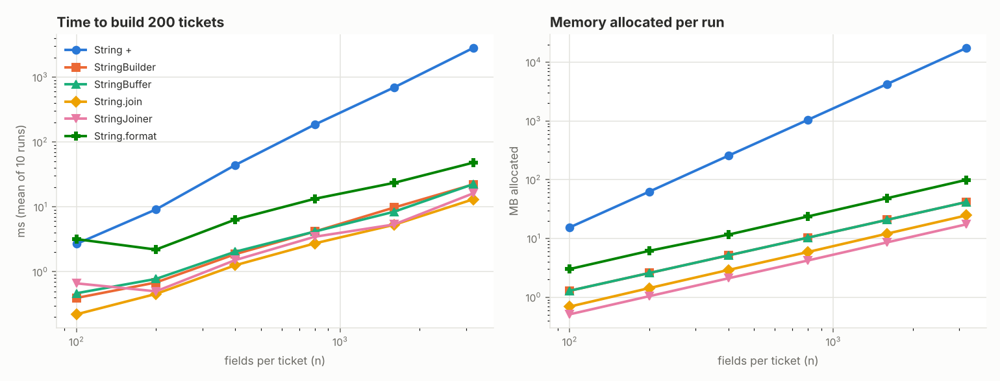
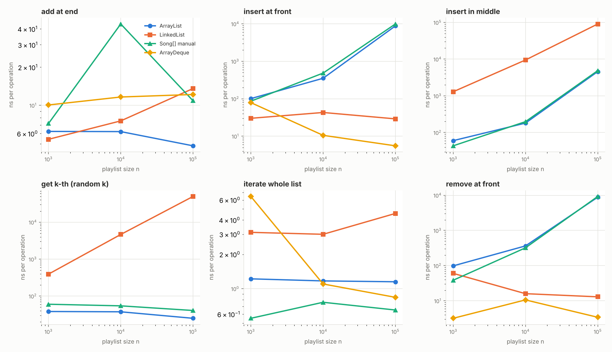
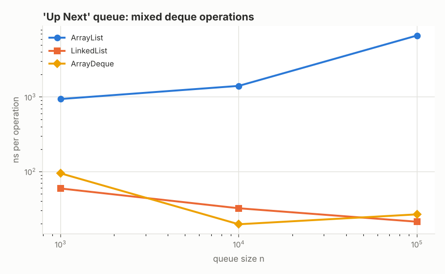
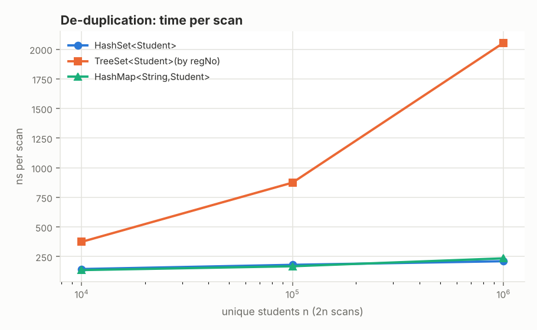
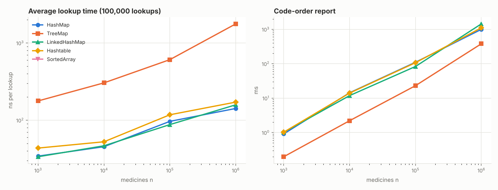
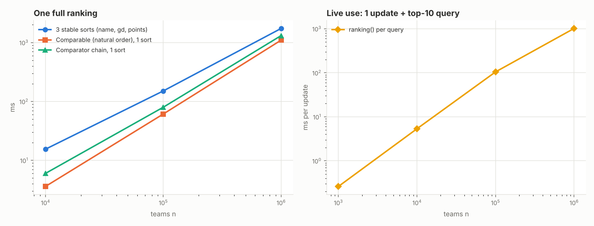
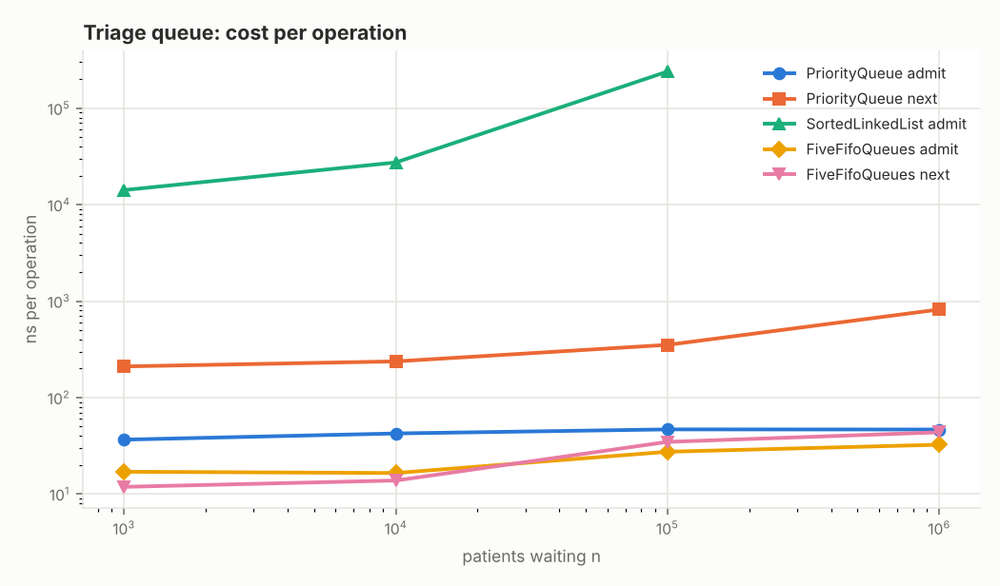
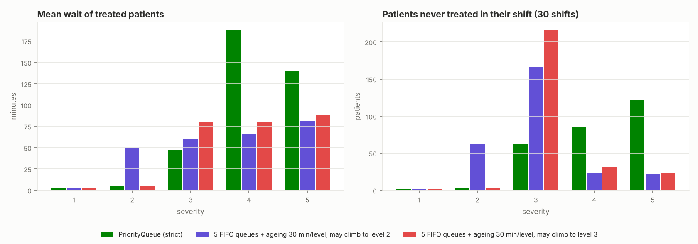
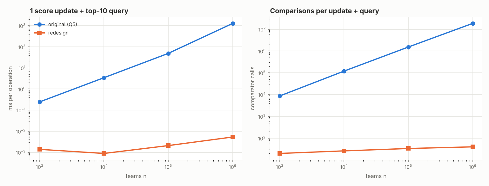

| | |
|---|---|
| **Name** | `<YOUR NAME>` |
| **Register Number** | `<REGISTER NUMBER>` |
| **GitHub Repository** | `https://github.com/<username>/CSA09-<RegisterNumber>-Assignment2` |
| **Java Version** | OpenJDK 21 (the code compiles on JDK 17+) |
| **Submission Date** | `<DATE>` |

**How the evidence was produced.** Every number in this report comes from the programs in the repository, run on one machine (2 CPU cores, 7 GB RAM, OpenJDK 21) with `bash run_all.sh`. Each measurement is **repeated and averaged** after a JIT warm-up (usually 5–10 runs; the exact count is printed with every table). Every individual run is saved as raw data in `QN/data/*.csv`, the console output in `QN/output/*.txt`, and the graphs in `QN/graphs/*.png` are drawn from those CSV files by `tools/make_graphs.py`. Absolute times will differ on another machine; the **growth trend and the ratios** are the evidence.

**Repository layout.** `Q1` … `Q7`, each with source code, `input/`, `data/` (raw CSV), `output/` (console logs), `graphs/` and `screenshots/`; `report/`; `run_all.sh`; `tools/`.

\newpage

# Q1 – Building Text Under Load: String, StringBuilder or StringBuffer?

## 1.1 Prediction (written before implementation)

| Approach | Predicted behaviour as fields (n) and tickets (t) grow | Reason |
|---|---|---|
| `String +` in a loop | time and memory grow with **n²** per ticket, × t | `String` is immutable, so `s += field` cannot extend `s`: it allocates a new String and copies all characters so far. Building a ticket of n fields creates n intermediate Strings and copies L·(1+2+…+n) ≈ L·n²/2 characters (L = average field length). |
| `StringBuilder` | linear in n, × t | One mutable buffer; `append` writes into spare capacity; when full the buffer doubles (amortised O(1) per character). Only the final `toString()` creates a String. |
| `StringBuffer` | linear, slightly slower than StringBuilder | Same algorithm, but every `append` is `synchronized`. Without contention the JVM makes this lock cheap, so I predicted only a small (≤ 20 %) overhead. |

**Prediction for "short ticket":** with 12 fields the difference is negligible in absolute terms (microseconds), because n² is still small. **For long tickets** `+` should become dramatically worse.

## 1.2 Workloads (`Q1/input/workloads.txt`)

| Workload | Tickets × fields | Why it was chosen |
|---|---|---|
| **W1 – short** | 1 × 12 | a single normal booking – tests whether the choice matters at all |
| **W2 – bulk** | 10,000 × 50 | the night batch from the question: many tickets, moderate length |
| **W3 – group manifest (own)** | 20 × 4,000 | few tickets but very long (a group-booking manifest) – isolates the n² effect |
| **Scaling sweep (own)** | 200 × 100, 200, 400, 800, 1,600, 3,200 | doubles n each step so the growth rate can be read directly |

Each approach was run 2 times for warm-up and then 10–30 measured times. The program also checks that all six approaches produce **identical** ticket text.

## 1.3 Results (`Q1/output/TicketBenchmark.txt`, `Q1/data/q1_summary.csv`)

| Workload | Measure | `String +` | StringBuilder | StringBuffer | String.join | StringJoiner | String.format |
|---|---|---|---|---|---|---|---|
| W1 (1×12) | mean ms | 0.035 | 0.006 | 0.014 | 0.017 | 0.033 | 0.040 |
| W2 (10,000×50) | mean ms | 35.1 | 14.4 | 14.5 | 9.5 | 10.8 | 31.6 |
| W2 | MB allocated / run | 195.6 | 32.5 | 32.6 | 17.2 | 12.7 | 74.6 |
| W2 | intermediate Strings (est.) | 500,000 | 10,000 | 10,000 | 10,000 | 10,000 | 20,000 |
| W3 (20×4,000) | mean ms | **442.9** | 1.37 | 1.78 | 1.39 | 1.69 | 6.14 |
| W3 | MB allocated / run | **2,743** | 4.4 | 4.4 | 3.1 | 2.0 | 11.1 |

Scaling sweep (200 tickets, mean of 10 runs):

| fields n | `+` ms | ratio to previous | StringBuilder ms | ratio | `+` MB allocated | StringBuilder MB |
|---|---|---|---|---|---|---|
| 100 | 2.69 | – | 0.39 | – | 15.4 | 1.3 |
| 200 | 9.11 | 3.4× | 0.68 | 1.7× | 62.3 | 2.6 |
| 400 | 44.1 | 4.8× | 1.87 | 2.7× | 255.6 | 5.1 |
| 800 | 184.8 | 4.2× | 4.16 | 2.2× | 1,038.9 | 10.3 |
| 1,600 | 691.1 | 3.7× | 9.75 | 2.3× | 4,235.8 | 20.7 |
| 3,200 | 2,814.6 | 4.1× | 22.2 | 2.3× | 17,429.2 | 41.6 |

{width=100%}

"Heap MB before → after" is recorded too (e.g. W3: `+` 7→266 MB vs StringBuilder 7→52 MB) but it is a noisy measure because the garbage collector runs at unpredictable moments; the **bytes allocated** counter (per-thread allocation from `ThreadMXBean`) is the reliable memory measure.

## 1.4 Prediction vs observation

* **`+` is quadratic – confirmed.** Each doubling of n multiplies time by ≈4 (3.4–4.8×) and allocated memory by exactly ≈4 (15→62→256→1,039→4,236→17,429 MB). At 3,200 fields `+` allocated **17 GB** to build 200 tickets of 58 KB each.
* **StringBuilder is linear – confirmed** (≈2× per doubling; 41.6 MB allocated ≈ 2 × the output size because of buffer doubling and the final copy).
* **Short tickets – confirmed negligible.** W1 differs by 0.03 ms. For a single booking the choice does not matter; it matters once tickets are long *or* there are many of them.
* **StringBuffer overhead – smaller than predicted.** 0–30 % slower (W2: 14.5 vs 14.4 ms); uncontended locks are almost free.
* **Not predicted:** in W2 `+` was "only" 2.4× slower. Since Java 9, `s += a + "|"` is compiled to one `invokedynamic` concatenation that sizes the result exactly, so with 50 short fields the n² copying is still small. The quadratic term only dominates when n is large (W3: **323×** slower).

## 1.5 Design decision – multithreaded booking server (`SharedLogDemo`)

4 threads × 50,000 bookings append to **one shared log**; 10 trials; each log line is checked against the pattern `T<id> PNR:<10 digits> B2-<berth> Rs 845.00`.

| Design | mean ms | trials corrupted | what went wrong |
|---|---|---|---|
| A – shared **StringBuilder** | 24.5 | **9 of 10** | up to 5 million characters lost, `ArrayIndexOutOfBoundsException` in 3 trials, broken lines |
| B – shared **StringBuffer** (many small appends) | 55.9 | **2 of 10** | length always correct, but **31,264** and **4,589** interleaved lines: each `append` is atomic, a *line* made of 7 appends is not |
| C – thread-local StringBuilder per ticket + one `synchronized` append of the finished line | 39.6 | 0 of 10 | – |
| D – thread-local StringBuilder + `ConcurrentLinkedQueue<String>` of finished lines | 35.1 | 0 of 10 | – |

**Recommendation.**

* **Per-ticket text → `StringBuilder`.** The ticket is built inside one request by one thread (a local variable is never shared), so synchronisation is pure overhead, and the experiments show StringBuilder is linear and fastest of the three mutable choices.
* **Shared log → not a bare StringBuilder (proven unsafe), and not "StringBuffer with many appends" either.** StringBuffer is thread-safe *per call*, which is the wrong granularity for log lines. The correct design is to build each line locally with StringBuilder and publish it with **one** atomic operation: a single `StringBuffer.append(line)` (equivalent to design C) or a concurrent queue (design D) that a writer thread drains to a file. D was the fastest correct design and keeps the lock out of the booking threads.

## 1.6 Alternative concept – String.join, StringJoiner, String.format

```java
String.join("|", fields) + "|";                         // one pass, exact size
StringJoiner j = new StringJoiner("|", "", "|"); for (String f : fields) j.add(f); j.toString();
String.format("%s|".repeat(n), (Object[]) fields);     // parses a format string with n specifiers
```

| Approach | Time for n fields | Intermediate String objects | Extra space |
|---|---|---|---|
| repeated `+` | Σ_{i=1..n} i·L = **O(n²)** characters copied | n (each a longer copy) | Σ of all prefixes = O(n²) chars of garbage |
| StringBuilder | O(n·L) amortised (≤ log₂ n buffer doublings, total copied < 2·nL) | 1 (final) | buffer ≤ 2·nL + final copy |
| String.join / StringJoiner | O(n·L), sizes the result once | 1 (StringJoiner keeps the parts array) | n references + result |
| String.format | O(n·L) + pattern parsing | 2 (pattern + result) + n `FormatSpecifier` objects | pattern string + specifiers + internal StringBuilder |

Measured: join/StringJoiner were the **fastest and leanest** for building a whole ticket from an array (W2: 9.5 ms / 12.7 MB), because they know all parts in advance. `String.format` is linear but 2–4× slower than StringBuilder (parsing), so it suits formatting a few fields, not assembling hundreds. When fields are produced one at a time (loops, conditions), StringBuilder remains the general answer.

\newpage

# Q2 – When Is ArrayList an Appropriate Engineering Choice?

## 2.1 Experiment design (`Q2/PlaylistBenchmark.java`)

* Songs come from `input/songs.csv` (200 songs, cycled to build playlists of **1,000 / 10,000 / 100,000** songs).
* Structures: `ArrayList`, `LinkedList`, a plain `Song[]` with manual shifting (alternative concept), and `ArrayDeque` where the operation exists.
* For each operation the playlist is pre-built, then **1,000 operations** are timed (add-at-end and iterate are timed over all n); 7 measured runs after a global warm-up (every kernel run 30 times at n = 10,000) and per-cell warm-up. Each timed loop is its own small method so the JIT compiles each one separately (an earlier version that timed everything inside one large method produced interpreter-speed numbers – I detected this because ArrayList iteration measured ~100 ns/element at every size).

## 2.2 Results – ns per operation (mean of 7 runs)

| Operation | Structure | n = 1,000 | n = 10,000 | n = 100,000 |
|---|---|---|---|---|
| add at end | ArrayList | 6.2 | 6.2 | 4.8 |
| | LinkedList | 5.4 | 7.5 | 13.6 |
| insert at front | ArrayList | 101.0 | 352.2 | **8,792** |
| | LinkedList | 30.1 | 43.0 | 29.1 |
| | ArrayDeque | 78.8 | 10.5 | 5.5 |
| | Song[] manual | 86.1 | 485.1 | 9,917 |
| remove at front | ArrayList | 98.6 | 363.7 | **8,825** |
| | LinkedList | 60.3 | 16.0 | 13.0 |
| | ArrayDeque | 3.2 | 10.6 | 3.4 |
| insert in middle (by index) | ArrayList | 60.1 | 180.9 | 4,577 |
| | LinkedList | 1,293 | 9,478 | **90,765** |
| insert in middle via ListIterator (already positioned) | LinkedList | 19.4 | 30.8 | 146.0 |
| remove in middle | ArrayList | 144.2 | 155.1 | 4,917 |
| | LinkedList | 461.7 | 9,036 | **93,397** |
| get k-th (random k) | ArrayList | 38.2 | 37.5 | 25.0 |
| | LinkedList | 392.6 | 4,654 | **49,736** |
| iterate (per element) | ArrayList | 1.2 | 1.2 | 1.1 |
| | LinkedList | 3.1 | 3.0 | 4.6 |
| | Song[] manual | 0.5 | 0.8 | 0.6 |

{width=100%}

Memory per element (1,000,000 references, heap delta after GC): **ArrayList 5.2 B, Song[] 5.2 B, ArrayDeque 5.2 B, LinkedList 24.0 B** (a node = header + item + next + prev).

## 2.3 Evidence-based operating boundary

ArrayList is a **reasonable engineering choice** when the playlist is mostly *appended to, browsed, jumped into and played in order*: add-at-end ≈ 5 ns, `get(k)` constant ≈ 25–38 ns at every size, iteration ≈ 1 ns/song (4× faster than LinkedList thanks to contiguous memory), and ¼ of LinkedList's memory. Middle edits are O(n) but a fast `System.arraycopy`: 4.6 µs at 100,000 songs is still imperceptible for a person editing a playlist.

LinkedList never wins by index: inserting "at position k" costs a walk of k nodes (90 µs at 100,000 – **20× slower** than ArrayList) and `get(k)` is 2,000× slower. Its only real win is inserting/removing **at an iterator that is already in place** (146 ns) or at the ends.

**I would stop recommending ArrayList** when operations at the **front** become frequent on long lists: insert/remove at index 0 grows linearly (8.8 µs at 100,000 – 1,600× ArrayDeque), so a loop of n front-operations is O(n²). As a rule from these measurements: ArrayList is fine up to ~10,000 songs for occasional front edits (<0.4 µs each), and should be replaced when front operations are a regular part of the workload.

## 2.4 Changed condition – the "Up Next" queue

Mixed workload (40 % `addLast`, 20 % `addFirst`, 40 % `pollFirst`), 200,000 operations, ns per operation:

| Structure | n = 1,000 | n = 10,000 | n = 100,000 |
|---|---|---|---|
| ArrayList (`add(0,x)`, `remove(0)`) | 938.7 | 1,408.0 | **6,664.0** |
| LinkedList | 59.2 | 32.2 | 21.2 |
| ArrayDeque | 94.6 | 19.6 | 26.6 |

{width=60%}

**Re-evaluation:** ArrayList is the wrong structure for Up Next – its cost grows with the queue length. Both deques are constant per operation; **ArrayDeque is recommended**: same O(1) behaviour as LinkedList, 5 bytes instead of 24 per entry, no node allocation per add, and it is the class the JDK recommends for stacks and queues. The playlist itself can stay an ArrayList; Up Next becomes a separate `ArrayDeque<Song>`. (At n = 1,000 the two deques differ by tens of nanoseconds – within run-to-run noise.)

## 2.5 Alternative concept – complexity table and the plain array

| Operation | ArrayList | LinkedList | ArrayDeque | Song[] + manual shifting |
|---|---|---|---|---|
| add at end | O(1) amortised | O(1) | O(1) amortised | O(1) amortised (manual doubling) |
| insert at front | O(n) shift | O(1) | O(1) | O(n) shift |
| insert in middle (index) | O(n) shift | O(n) walk + O(1) link | not supported | O(n) shift |
| get k-th | O(1) | O(n) walk (from nearer end) | not supported (O(k) by iterating) | O(1) |
| iterate | O(n), cache-friendly | O(n), pointer chasing | O(n) | O(n), fastest |
| space per element | 1 reference (+ ≤50 % spare capacity) | node: ≈24 B | 1 reference (power-of-two ring) | 1 reference (+ spare capacity) |

The plain array is what ArrayList does internally, so its complexity is identical and the measurements match ArrayList closely (front insert 9.9 µs vs 8.8 µs at 100,000). It saves a bounds-check and a method call (iteration 0.6 vs 1.1 ns) but I had to write and test growth, shifting and bounds handling myself, and it has no `Iterator`, no generics safety and no fail-fast behaviour – not worth it.

\newpage

# Q3 – Engineer the hashCode–equals Contract

## 3.1 Complete the Code – before and after TODO 1

| Run | Code | Output |
|---|---|---|
| Before TODO 1 (`before_todo/Attendance.java`, run 3 times) | `hashCode()` not overridden | **`Unique students: 3`** (every run) |
| After TODO 1 (`Attendance.java`) | `@Override public int hashCode() { return regNo.hashCode(); }` | **`Unique students: 2`** ✔ expected |

**Difference:** without `hashCode()`, the two `Arun` objects use `Object.hashCode()` (identity-based), so they get different hash codes and land in different buckets. `HashSet` only calls `equals()` on elements in the *same* bucket with the *same* hash, so it never discovers that they are equal and keeps both.

## 3.2 Designed tests – prediction before execution (`Q3/ContractLab.java`, `input/scans.csv`)

| Test | Design | Predicted size | Observed | Reason |
|---|---|---|---|---|
| **1 – appears to work** | broken class; 4 students; 2 re-scans reuse the **same object** (reader cache) | 4 | **4** ✔ | same reference → same identity hash → same bucket → `equals()` true → rejected |
| **2 – exposes duplicates** | broken class; 3 students, 6 scans, **new object per scan** | 6 | **6** ✔ | different identity hashes (e.g. 1826771953 vs 245257410 for the same Arun) → different buckets → `equals()` never called; `contains(new Arun)` = false |
| 2 with corrected class | same 6 scans | 3 | **3** ✔ | equal regNo → equal hash (822376264 for Arun every time) → same bucket 12 → found |
| **3a (own) – key changed after insertion** | correct `hashCode`, but mutable `regNo`; typo `192311O01` corrected to `192311001` after adding | 2 after re-scan | **2** ✔ | entry stays in old bucket 3 while its hash now points to bucket 12: `contains(same object)` = false, `remove` = false, re-scan adds a second Arun |
| **3b (own) – TreeSet inconsistent with equals** | `TreeSet` ordered by **name**; two different students named Arun, Divya/DIVYA | 3 | **3** ✔ | TreeSet uses **only** `compare()`: the 2nd Arun compares 0 → silently lost; "Divya" ≠ "DIVYA" → same student counted twice |
| 3b case-insensitive name | | 2 | **2** ✔ | Divyas merge, second Arun still lost |
| 3b ordered by regNo | | 3 | **3** ✔ | `compare()==0` exactly when `equals()` is true |

All seven predictions were confirmed.

## 3.3 Inquiry

* **Why the duplicates appear:** the contract says *if `a.equals(b)` then `a.hashCode() == b.hashCode()`*. The junior class breaks it (`equals` on regNo, `hashCode` on identity), so hashing sends equal objects to different places.
* **How HashSet locates an element:** (1) `h = key.hashCode()`; (2) spread `h ^ (h >>> 16)`; (3) bucket index = `h & (table.length − 1)` (the program prints these buckets); (4) walk that bucket and for each entry compare the stored hash, then `==`, then `equals()`. `equals()` is the *last* step – it is never reached if the hash is wrong.
* **Changing a hashed field after insertion:** the element is stored under the bucket of its *old* hash. Lookups use the *new* hash, so the element becomes unreachable – it cannot be found or removed, and an "equal" object is added again (test 3a). Hash keys must be immutable.
* **Correction:** make the key field `final`, override `hashCode()` from exactly the fields used in `equals()` (`regNo.hashCode()` or `Objects.hash(regNo)`), and use `instanceof` pattern + `getClass()` reasoning consistently. **Verification:** (i) the Complete-the-Code output becomes 2; (ii) test 2 with the corrected class gives 3; (iii) a randomised property test – 50,000 scans of 2,000 students – gave set size 2,000 = distinct regNos and **0** pairs where `equals` is true but hashes differ (PASS).

## 3.4 Alternative concept – TreeSet with a Comparator, HashMap keyed by regNo

```java
Set<Student> seen = new TreeSet<>(Comparator.comparing(Student::regNo));   // needs no hashCode at all
Map<String, Student> seen = new HashMap<>();  seen.putIfAbsent(s.regNo(), s); // key is an immutable String
```

Measured (2n scans in random order, mean of 5 runs) and container overhead per unique student:

| Structure | n = 10,000 | n = 100,000 | n = 1,000,000 | time per scan | bytes / student |
|---|---|---|---|---|---|
| HashSet<Student> | 145 ns | 181 ns | 211 ns | O(1) average | 37.3 |
| TreeSet<Student> (by regNo) | 375 ns | 875 ns | 2,055 ns | O(log n) comparisons of Strings | 35.9 |
| HashMap<String, Student> | 136 ns | 169 ns | 236 ns | O(1) average | 38.3 |

{width=60%}

Space is O(n) for all three and almost identical per entry (a HashMap node ≈ 32 B + table slot; a TreeMap entry ≈ 40 B, no table). HashSet/HashMap stay nearly flat (the small rise is cache misses); TreeSet grows with log n and is **10×** slower at 1 million. The `HashMap<String,Student>` design is the most robust: the key is an immutable `String` whose `hashCode`/`equals` are correct by construction, so it cannot be broken by a faulty `Student` class. TreeSet is only worth it if the attendance list must also be printed in regNo order.

\newpage

# Q4 – Choosing a Map for a Pharmacy Inventory

## 4.1 Design reasoning (before implementation)

| | HashMap | TreeMap | LinkedHashMap |
|---|---|---|---|
| `put` / `get` | O(1) average | O(log n) | O(1) average |
| iteration order | none (bucket order) | sorted by key | insertion order |
| Report 1 – code order | needs extra work: copy keys + sort, O(n log n) | **natural**, O(n) | extra sort, O(n log n) |
| Report 2 – order added | impossible without an extra `List` of codes in arrival order | extra list | **natural**, O(n) |
| memory | node + table | tree entry (no table) | node + 2 extra links |

**Extra work if the "wrong" map is chosen:** code order from a hash map = `keySet().toArray()` + `Arrays.sort` (O(n log n)); arrival order from HashMap/TreeMap = maintain a separate `ArrayList<String>` of codes on every new `put` and look each one up when printing (O(n) extra space, O(n) lookups). The program implements exactly this extra work so every map produces both reports.

## 4.2 Correctness on the sample file (`input/medicines_sample.csv`, 20 medicines)

Plain iteration without any extra work: HashMap matches **neither** order; TreeMap matches code order only; LinkedHashMap matches arrival order only. With the extra work, all maps produced both reports in the required order at every size (`code ok` / `arr ok` = true in every row).

## 4.3 Measurements (100,000 lookups: 90 % hits, 10 % unknown codes; mean of 5 runs)

| Map | n | put ns/op | 100k lookups ms | ns / lookup | p99 ns | code report ms | arrival report ms |
|---|---|---|---|---|---|---|---|
| HashMap | 1,000 | 941 | 3.4 | 34 | 193 | 0.9 | 0.1 |
| TreeMap | 1,000 | 301 | 17.8 | 178 | 336 | 0.2 | 0.3 |
| LinkedHashMap | 1,000 | 135 | 3.4 | 34 | 141 | 1.0 | 0.2 |
| HashMap | 10,000 | 277 | 4.5 | 45 | 359 | 14.3 | 1.7 |
| TreeMap | 10,000 | 438 | 30.4 | 304 | 692 | 2.2 | 4.5 |
| LinkedHashMap | 10,000 | 145 | 4.7 | 47 | 417 | 11.8 | 1.5 |
| HashMap | 100,000 | 333 | 9.7 | 97 | 933 | 109.9 | 25.0 |
| TreeMap | 100,000 | 698 | 60.8 | 608 | 1,312 | 23.0 | 71.5 |
| LinkedHashMap | 100,000 | 231 | 8.8 | 88 | 900 | 82.9 | 12.5 |
| HashMap | 1,000,000 | 291 | 14.2 | 142 | 1,077 | 994.0 | 274.9 |
| TreeMap | 1,000,000 | 1,802 | **176.5** | **1,765** | 3,924 | **378.9** | 1,791.8 |
| LinkedHashMap | 1,000,000 | 372 | 15.8 | 158 | 1,230 | 1,433.1 | **89.9** |
| Hashtable | 1,000,000 | 276 | 17.1 | 171 | 1,265 | 1,102.9 | 413.3 |

(Full table, including Hashtable at all sizes and the sorted array, in `Q4/output/PharmacyInventory.txt`. The HashMap put time at n = 1,000 includes table resizing on a cold path and is noisy.)

{width=100%}

## 4.4 Scalability inquiry and decision

**Acceptability criterion.** A pharmacist's lookup is acceptable if the **99th-percentile lookup time is below 10 µs** (the data structure must be invisible next to screen and network latency of ~100 ms), and each evening report must finish in under 1 second.

* Every map meets the lookup criterion by a wide margin – even TreeMap's p99 at 1,000,000 medicines is 3.9 µs. A real hospital pharmacy holds ~5,000–20,000 items, where all maps answer in < 0.7 µs (p99).
* HashMap/LinkedHashMap lookups are 5–12× faster than TreeMap and grow only slowly (34 → 158 ns from 1,000 to 1,000,000 – cache misses, not algorithmic growth); TreeMap grows with log n (178 → 1,765 ns).

**Decision: deploy `LinkedHashMap<String, Medicine>`.** It gives O(1) lookups (the operation done hundreds of times a day) and produces the arrival-order report for free; the code-order report needs one sort per evening, which at a realistic 10,000 medicines costs 12 ms. TreeMap would make the code report free but every lookup 6× slower, and its arrival report needs a second list – a bad trade for a lookup-heavy system.

**Where the remaining cost comes from:** for lookups – computing `String.hashCode()` (cached after first use) and the cache miss when reaching the bucket and the `Medicine` object; for the reports – not the map at all but **sorting the keys (O(n log n)) and building the report text**: at 1,000,000 medicines the LinkedHashMap code report spends ~1.4 s, almost all in `Arrays.sort` of String keys.

**Why not Hashtable:** it is a legacy class (Java 1.0) that synchronises *every* method on one lock – correct but a bottleneck when several pharmacist terminals read at once, and still not safe for compound actions (check-then-update stock) without external locking. It also rejects `null` keys/values and has no insertion-order or sorted variant. Single-threaded, it measured about the same as HashMap here (uncontended locks are cheap), so its cost appears under contention. New code should use `HashMap`/`LinkedHashMap` (single-threaded) or `ConcurrentHashMap` (concurrent).

## 4.5 Alternative concept – sorted array + `Arrays.binarySearch`

```java
Arrays.sort(meds, comparing(Medicine::code));          // build once: O(n log n)
int i = Arrays.binarySearch(codes, 0, size, code);     // lookup: O(log n)
// insert: binary search for position, then System.arraycopy to shift: O(n)
// code-order report: walk the array: O(n), no sort needed
```

| | Sorted array | HashMap | TreeMap |
|---|---|---|---|
| lookup | O(log n): measured 381 → 1,178 ns | O(1): 34 → 142 ns | O(log n): 178 → 1,765 ns |
| insert one new medicine | **O(n) shift**: 4.6 µs → **190.9 µs** at 1M | O(1) | O(log n) |
| code-order report | O(n): **234 ms** at 1M (fastest) | O(n log n): 994 ms | O(n): 379 ms |
| space per item | 2 references (≈8 B) – most compact | node ≈32 B + table | entry ≈40 B |

The sorted array is a good fit for a **read-only** catalogue (compact, sorted report for free, cache-friendly binary search), but a live inventory receives new medicines, and each insertion shifts on average n/2 elements – 191 µs per insert at 1,000,000 items, growing linearly – so it is rejected for this system.

\newpage

# Q5 – Derive a Generic Ranking Component from a Principle

## 5.1 Complete the Code

```java
List<T> ranking() {
    List<T> copy = new ArrayList<>(items);   // copy first: items keeps insertion order
    copy.sort(order);                        // List.sort = stable TimSort, O(n log n)
    return copy;
}
Comparator<Team> byRank = Comparator.comparingInt((Team t) -> t.points).reversed()
        .thenComparing(Comparator.comparingInt((Team t) -> t.goalDiff).reversed())
        .thenComparing(t -> t.name);
```

Output: `[Eagles(9,6), Bisons(9,4), Panthers(9,4), Cobras(6,1)]` – **identical to the expected output**.

**Why Bisons is above Panthers:** both have 9 points (first key equal) and goal difference 4 (second key equal), so the third key decides: names in A–Z order, and "Bisons" < "Panthers" because 'B' (66) < 'P' (80). It is *not* because of insertion order – Panthers was added first, and a correct comparator must not depend on that.

## 5.2 Design derived from the principle

The principle requires a **consistent total order**: antisymmetric (sign of compare(a,b) = −sign of compare(b,a)), transitive, and compare = 0 only for items that are genuinely equal.

| Decision | Choice | Reason |
|---|---|---|
| Comparable or Comparator? | **Separate `Comparator` objects** | A team has no single "natural" order (by name for a directory, by points for a table). Comparable fixes one order inside the class; Comparators keep rules outside, reusable and replaceable. |
| Multi-field rule | `comparingInt(points).reversed().thenComparing(comparingInt(goalDiff).reversed()).thenComparing(name)` | `comparingInt` uses `Integer.compare` (no subtraction → no overflow); each `reversed()` applies to **one** key only; the unique name makes the order **total**. |
| Generic, reusable class | `Leaderboard<T>` with `Comparator<? super T>`; interface `Rankable { primary(); secondary(); name(); }`; `static <T extends Rankable> Comparator<T> standard()`; `RankedBoard<T extends Rankable>` | The **bounded type** `T extends Rankable` lets one comparator rank `Team`, `Player` and `College` (all shown working in `RankingLab` output). |
| Wildcards | `Comparator<? super T>` (consumer), `addAll(Collection<? extends T>)` (producer), `averagePrimary(List<? extends Rankable>)` | PECS: a `Leaderboard<Rankable>` accepts a `List<Team>`; a `Comparator<Rankable>` can sort a `List<Team>`. The output shows a mixed board of Teams and Players. |

## 5.3 Test data and faulty comparators

* **Data set 1** (`teams_ties.csv`, 12 teams): ties on points (five teams on 9), on points + goal difference (three teams on 9,4), and full ties broken only by name. Hand-worked ranking in `expected_ties.txt`.
* **Data set 2** (`teams_adversarial.csv`, designed to break faulty comparators): points ±2,000,000,000 and goal differences ±1,500,000,000 (so `b − a` overflows `int`), and two full ties (Zebras/Ants, Moles/Lions) decided only by name. Hand-worked ranking in `expected_adversarial.txt`.

Each comparator is also run through a **contract checker** that tests every pair and triple (antisymmetry, transitivity, compare(a,a) = 0), and sorted from two input orders (original and reversed) to see whether the result depends on input order.

| Comparator | Set 1 matches hand ranking | Set 2 matches | order-independent? | antisymmetry violations | transitivity violations |
|---|---|---|---|---|---|
| **Correct** `Orders.standard()` | YES | YES | yes | 0 / 0 | 0 / 0 |
| F1 subtraction `b.points − a.points` | YES | **no** (Comets first, Overlords 6th) | no on set 2 | 0 / 0 | 0 / **24** |
| F2 ignores name tie-break | no | no | **no** – depends on input order | 0 / 0 | 0 / 0 |
| F3 `a.points >= b.points ? −1 : 1` | no | no | no | **46 / 22** | 0 / 0 (+ compare(a,a) ≠ 0 for every item) |
| F4 `.reversed()` on the whole chain | no (names Z–A) | no | yes | 0 / 0 | 0 / 0 |

F3 on larger random data: `IllegalArgumentException: Comparison method violates its general contract!` in **5 of 50** sorts of 2,000 teams – TimSort detects the violation only sometimes, so a broken comparator can pass small tests and crash in production.

## 5.4 Correctness argument (reasoning, not output)

The comparator is a **lexicographic order** on the key tuple (−points, −goalDiff, name):

1. Each component comparison is itself a total order: `Integer.compare` on ints (exact, no overflow, unlike subtraction – F1 fails precisely because `b − a` wraps for |a − b| > 2³¹ − 1, making "2,000,000,000 vs −2,000,000,000" negative), its reversal, and `String.compareTo` (lexicographic on UTF-16 code units).
2. A lexicographic combination of total orders is a total order: compare(a,b) is decided by the **first** key where they differ. *Antisymmetry*: swapping a and b reverses that first difference, so the sign flips. *Transitivity*: if a < b and b < c, let i and j be the first differing keys; the first key where a and c differ is min(i, j), and at that key a is smaller – so a < c.
3. **Equal items compare as equal, and only those:** compare = 0 requires equal points, goal difference **and** name. Names are unique per competition, so distinct teams never compare 0 – the ranking is fully determined (F2 lacks this: distinct teams compare 0 and their order depends on input order).

## 5.5 Alternative concept – Comparable, or three stable sorts

```java
class Team implements Comparable<Team> { public int compareTo(Team o) {          // one fixed order
    int c = Integer.compare(o.points, points); if (c != 0) return c;
    c = Integer.compare(o.goalDiff, goalDiff); return c != 0 ? c : name.compareTo(o.name); } }
list.sort(comparing(Team::name));                         // least important key first
list.sort(comparingInt(Team::goalDiff).reversed());       // stable: keeps name order inside ties
list.sort(comparingInt(Team::points).reversed());         // most important key last
```

Time for one full ranking (ms, mean of 5 runs; all three verified to give identical rankings):

| Approach | sorts | n = 10,000 | n = 100,000 | n = 1,000,000 | extra space |
|---|---|---|---|---|---|
| Comparator chain | 1 × O(n log n) | 6.0 | 79.8 | 1,310.7 | copy n + TimSort buffer ≤ n/2 |
| Comparable | 1 × O(n log n) | 3.6 | 61.2 | 1,097.1 | same |
| 3 stable sorts | 3 × O(n log n) | 15.5 | 150.9 | 1,733.5 | same, used 3 times |

{width=100%}

Comparable is 15–40 % faster (one hand-written method, no lambda chain) but **least reusable** – Players and Colleges would each need their own `compareTo`, and a second order (e.g. by name) is impossible. Three stable sorts are correct only because TimSort is stable, and cost ~1.3–2.6× more. The **Comparator chain with `Rankable`** is the easiest to reuse for players and colleges: one generic comparator, no change to the classes.

The right-hand graph shows how the Leaderboard behaves in **live use** (one score update, then a top-10 query): 0.26 ms at 1,000 teams but **1,017 ms at 1,000,000**, because every query re-sorts everything. This is investigated in Q7.

\newpage

# Q6 – Priority, Order and Fairness in a Queue

## 6.1 Design (developed without supplied code – `TriageLab.java`)

* **Why a plain Queue is not enough:** `ArrayDeque`/`LinkedList` are FIFO – they serve in *arrival* order. The output shows the FIFO order `[Ravi(S3), Meena(S1), …]`: a critical patient waits behind a minor one.
* **Rule as one Comparator:** `comparingInt(Patient::severity).thenComparingLong(Patient::seq)` – severity 1 first; for equal severity, the smaller arrival sequence first. `PriorityQueue` keeps a binary min-heap ordered by this comparator, so `poll()` always returns the minimum.
* **Arrival order among equal severities:** each admitted patient gets `seq = counter++`, a **unique, strictly increasing** number. Two patients with equal severity therefore always compare by seq, and the earlier one is smaller. (PriorityQueue is *not* stable on its own – without seq, ties would come out in heap order.)
* **Removing and displaying:** `next()` = `poll()` (O(log n)). The waiting list is displayed by copying the heap into a list and sorting the copy with the same comparator (O(n log n)), leaving the queue untouched.

**Complete the Code** (`Triage.java`): `new PriorityQueue<>(Comparator.comparingInt((Patient p) -> p.severity).thenComparingLong(p -> p.arrival))` → output `Meena(S1) Kumar(S1) Lata(S2) Ravi(S3) John(S3) Asha(S5)` – **identical to expected**. The counter gives Meena 1 and Kumar 4; both S1, so Meena (1) < Kumar (4) and Ravi (0) before John (2) among S3.

## 6.2 Correctness check – hand-verified instance (`input/patients_8.csv`)

| Arrival | Patient | Severity | seq |
|---|---|---|---|
| 08:00 | Ravi | 3 | 0 |
| 08:03 | Meena | 1 | 1 |
| 08:05 | John | 3 | 2 |
| 08:06 | Asha | 5 | 3 |
| 08:10 | Kumar | 1 | 4 |
| 08:12 | Lata | 2 | 5 |
| 08:15 | Sanjay | 1 | 6 |
| 08:20 | Priya | 3 | 7 |

**By hand:** severity 1 in arrival order → Meena, Kumar, Sanjay; severity 2 → Lata; severity 3 → Ravi, John, Priya; then Asha (5). Program: `[Meena, Kumar, Sanjay, Lata, Ravi, John, Priya, Asha]` – **MATCH: true**.

**Why printing the PriorityQueue does not show treatment order:** `toString()` prints the internal **heap array**: `[Meena(S1), Kumar(S1), Sanjay(S1), Priya(S3), Ravi(S3), John(S3), Lata(S2), Asha(S5)]` – Lata (S2, treated 4th) appears 7th. A heap only guarantees that each parent ≤ its children (element i ≤ elements 2i+1 and 2i+2), so only the *first* element is guaranteed to be the minimum; the rest are in a partially ordered tree layout.

## 6.3 Growth investigation

**Prediction:** admit and next are both O(log n) (sift-up / sift-down along one root-to-leaf path of height log₂ n ≈ 10, 13, 17, 20 for the four sizes), so cost should rise slowly and roughly additively.

| Design / operation (ns, mean of 5 runs) | n = 1,000 | n = 10,000 | n = 100,000 | n = 1,000,000 |
|---|---|---|---|---|
| PriorityQueue admit | 36.6 | 42.4 | 46.7 | 46.6 |
| PriorityQueue next | 210.1 | 237.1 | 351.6 | 818.7 |
| Sorted LinkedList admit | 14,165 | 27,405 | 240,198 | not run |
| Sorted LinkedList next | 9.5 | 6.6 | 6.7 | not run |
| 5 FIFO queues admit | 17.0 | 16.5 | 27.4 | 32.4 |
| 5 FIFO queues next | 11.9 | 13.8 | 34.7 | 43.6 |

{width=70%}

* **next: prediction confirmed** – slow logarithmic growth (210 → 819 ns); the jump at 1,000,000 is larger than log n alone because the 1-million-entry heap no longer fits in CPU cache, so each level of the sift-down is a cache miss.
* **admit: better than predicted** – flat at ~45 ns. O(log n) is the *worst* case; with random severities a new patient usually stops after 1–2 levels of sift-up, so the *average* is O(1).

## 6.4 Starvation and a fair rule

**Why a severity-5 patient can wait indefinitely:** the rule always serves the lowest severity number. If more severe patients keep arriving at a rate ≥ the doctor's service rate, there is always someone ahead of the S5 patient, so its turn never comes – nothing in the rule depends on how long it has waited.

**Simulation** (30 independent 12-hour shifts, 1 doctor, 6 minutes per patient = 10/hour; arrivals S1 1.5, S2 3, S3 6, S4 0.5, S5 0.5 per hour – 11.5/h overload for 6 h, then S1–S3 × 0.75). Totals over 30 shifts:

| Design | S2 mean wait | S3 mean wait | S4 never treated / max wait | **S5 never treated / max wait** |
|---|---|---|---|---|
| Strict PriorityQueue | 4.8 min | 47.2 min | 85 of 196 / 712 min | **122 of 191 / 718 min** |
| Ageing, may climb to level 2 | 49.7 min | 59.8 min | 23 / 202 min | 22 / 174 min |
| **Ageing, may climb to level 3** | **4.8 min** | 80.0 min | 31 / 250 min | **23 / 246 min** |

(S1 identical in all designs: mean 2.5 min, max 10 min.)

{width=100%}

**Fair rule designed:** one FIFO queue per severity (5 `ArrayDeque`s). A waiting patient's *effective level* = severity − ⌊minutes waited / 30⌋, but never higher than a cap level; **severity 1 is never overtaken**. At each `next()`, only the five queue heads are candidates (inside a level the head has waited longest), so choosing is O(5) = O(1) per patient and no re-heapifying is needed when waiting times change – this is why the fair design uses level queues rather than a PriorityQueue (a heap cannot reorder itself as priorities change over time).

The first version (cap at level 2) cut S5 starvation from 122 to 22 patients but made S2 wait **10× longer** (4.8 → 49.7 min) because aged S3–S5 patients competed with S2. Capping ageing at **level 3** keeps S1 and S2 exactly as before, still cuts untreated S5 patients from 122 to 23 and their worst wait from 718 to 246 min; the cost is moved onto S3 (47 → 80 min). That is the version I recommend: clinically urgent patients are protected and every minor patient is eventually seen.

## 6.5 Deployment decision – 5,000 patients a day

A run of 5,000 admits and 3,334 treatments (backlog grows to 1,667) took **8.4 ms in total – 1.7 µs per patient**, and rebuilding the waiting-list display of 1,666 patients took 0.3 ms. 5,000 patients/day is ~3.5 per minute; at the measured ~0.2–0.8 µs per operation, even a 1,000,000-patient queue would be served in under a microsecond per operation. **Yes, the design can serve a city hospital** – the data structure uses less than one millionth of the available time. The real constraints are doctors (the simulation shows overload creates starvation regardless of data structure) and durability/concurrency: in production the queue must be persisted and accessed through a thread-safe wrapper (`PriorityBlockingQueue` or a lock) from several terminals. The fair level-queue design is O(1) and equally deployable.

## 6.6 Alternative concept – sorted LinkedList, five FIFO queues

```java
// sorted LinkedList: walk to the position, insert after equal severities
ListIterator<Patient> it = list.listIterator(list.size());
while (it.hasPrevious()) if (ORDER.compare(it.previous(), p) <= 0) { it.next(); break; }
it.add(p);                     // admit O(n);  next = list.pollFirst() O(1)
// five FIFO queues: q[severity].addLast(p)  O(1);  next = first non-empty of q[1..5]  O(5) = O(1)
```

| Design | admit | next | space | measured at n = 100,000 |
|---|---|---|---|---|
| PriorityQueue (binary heap) | O(log n) worst, O(1) average | O(log n) | n refs in one array | 47 ns / 352 ns |
| Sorted LinkedList | **O(n)** walk | O(1) | n nodes × 24 B | **240,198 ns** / 7 ns |
| Array of 5 FIFO queues | **O(1)** | **O(levels)** = O(1) | n refs in 5 ring buffers + 5 headers | 27 ns / 35 ns |

Because severity has only **5 possible values**, the five-queue design is optimal: O(1) both ways, FIFO inside a level gives arrival order without a counter comparison, and it supports the ageing rule. A PriorityQueue is the general solution when priorities are many or continuous. The sorted LinkedList is unusable at scale.

\newpage

# Q7 – Day-4 Design Challenge: Diagnose, Redesign and Validate

**Solution selected: the Q5 Leaderboard in live use** – a score update followed by a "show the top 10" query, as on a sports-meet results screen. Q5's own measurements showed the cost growing from 0.26 ms (1,000 teams) to 1,017 ms (1,000,000 teams) per update.

## A. Diagnose the bottleneck

Instrumented original (`Q7/LeaderboardRedesign.java`, section A; same teams and update sequence as Q5):

| n | total ms per update + query | copy ms | sort ms | sort share | comparisons per query | bytes allocated per query |
|---|---|---|---|---|---|---|
| 1,000 | 0.50 | 0.007 | 0.48 | 96.1 % | 8,689 | 7,312 |
| 10,000 | 4.17 | 0.032 | 4.12 | 98.9 % | 120,342 | 92,208 |
| 100,000 | 47.8 | 0.089 | 47.7 | 99.8 % | 1,534,724 | 861,632 |
| 1,000,000 | 1,221.0 | 10.8 | 1,210.1 | 99.1 % | 18,641,091 | 8,096,896 |

* **Where the time is spent:** 96–99.8 % in `copy.sort(order)` – the full O(n log n) sort inside `ranking()`.
* **What grows:** comparisons per query grow as n log n (8.7 thousand → 18.6 million) and memory allocated per query grows linearly (7 KB → 8 MB: the copy plus TimSort's merge buffer).
* **Repeated work:** yes – after one update only **one** team's position can change, but every query re-sorts **all n** teams from scratch, and copies the whole list first. 18.6 million comparisons are spent to find 10 teams.
* **Cause:** `ArrayList` holds no ordering information between calls, and `ranking()` is defined to return a fresh sorted copy, so ordering knowledge is thrown away after every query.

## B. Design objective

1. **Keep the teams in ranking order permanently**, so an update repositions only the changed team and a top-k query reads k items – no re-sorting, no copying.
2. **Measurable:** one update + top-10 query in **≤ 50 µs at n = 1,000,000** (original: ~1.2 s), with cost growing at most O(log n + k); allocation per update independent of n.
3. **Correctness preserved:** after every update the top-10 must be *identical* to the original's (same comparator, same ties).
4. **Memory:** at most 2× the original's retained heap.

## C. Revised solution

**Pseudocode**

```
STRUCTURE IndexedLeaderboard<T, K>
    ordered : balanced search tree of T, ordered by a TOTAL-order comparator   (TreeSet)
    current : hash map K -> T  (the entry currently stored in the tree)        (HashMap)

PUT(item)                                   // insert or update
    old <- current.put(key(item), item)                 O(1)
    IF old ≠ NULL THEN ordered.remove(old)              O(log n)   (old is immutable, so it is still findable)
    IF NOT ordered.add(item) THEN ERROR "comparator is not a total order"   O(log n)

UPDATE(name, +points, +goalDiff)
    old <- current.get(name)                            O(1)
    PUT(new Team(name, old.points + points, old.goalDiff + goalDiff))

TOP(k)
    walk the first k nodes of ordered in order          O(log n + k)
```

**Class diagram (text form)**

```
IndexedLeaderboard<T, K>
 - ordered : TreeSet<T>              (Comparator<? super T> totalOrder)
 - current : HashMap<K, T>
 - key     : Function<? super T, ? extends K>
 + put(T) / get(K) / top(int) : List<T> / inOrder() : Iterable<T> / size()
        ▲ used by
RedesignedBoard implements Board  { update(name, p, g); top(k) }
Team (record, immutable)          Comparator RANK = Q5 Orders.standard()
```

* **What changed:** the list + sort-on-read was replaced by an always-sorted red-black tree (TreeSet) plus a hash index to find a team's current entry.
* **Property exploited:** a balanced search tree keeps elements ordered under insert/remove in O(log n), and in-order iteration from the smallest element costs O(1) per element; hashing finds the old entry in O(1).
* **Operations avoided:** the O(n log n) sort, the O(n) copy and the n-element merge buffer on every query.
* **Extra memory / preprocessing:** a tree entry (~40 B) + a hash node (~32 B) per team instead of one array slot; an initial build of n inserts (O(n log n)).
* **New trade-offs and requirements** (linked to earlier evidence):
    * The comparator **must be a total order**: TreeSet treats compare = 0 as "same element" and would silently drop a team (Q3 test 3b). The code checks this – a comparator without the name tie-break is rejected: `REJECTED: comparator is not a total order: Team[name=Bees …]`.
    * Entries **must be immutable**: changing points inside the tree would corrupt it exactly as changing regNo corrupted the HashSet in Q3 test 3a – so an update removes the old object and inserts a new one.
    * "What rank is team X?" becomes O(n) (TreeSet has no position index) – the original could binary-search its sorted copy.

## D. Prediction (made before implementation)

* Update + top-10 should cost **O(log n + 10)**: ~2·log₂ n comparisons (remove + insert) plus the walk of 10 nodes → about **20–45 comparisons** for n = 1,000 … 1,000,000 instead of thousands to millions, and **a few microseconds**, nearly flat across n.
* Allocation per update should be **constant** (one new Team + one tree node + one list of 10), independent of n.
* Improvement should grow with n: ~100× at 1,000 and ~10⁵× at 1,000,000.
* Costs: ~1.5–2× retained memory and a slower initial build (n tree insertions vs one sort).

## E. Implement and validate – same test conditions

Same teams (seed 2026), same update streams, same comparator (`LeaderboardRedesign.java` section E; raw runs in `data/q7_raw.csv`).

| n | Design | ms per update + top-10 | comparisons | bytes allocated | build ms | retained MB | speed-up |
|---|---|---|---|---|---|---|---|
| 1,000 | original | 0.24558 | 8,680 | 7,312 | 0.1 | ≈0* | |
| 1,000 | **redesign** | **0.00138** | **20** | **144** | 1.7 | 0.1 | **177×** |
| 10,000 | original | 3.44275 | 120,337 | 92,208 | 1.3 | 0.6 | |
| 10,000 | **redesign** | **0.00089** | **26** | **144** | 4.2 | 0.7 | **3,884×** |
| 100,000 | original | 49.00944 | 1,534,713 | 861,632 | 19.3 | 7.0 | |
| 100,000 | **redesign** | **0.00209** | **34** | **144** | 84.6 | 8.9 | **23,473×** |
| 1,000,000 | original | 1,292.85567 | 18,641,089 | 8,096,896 | 390.5 | 59.8 | |
| 1,000,000 | **redesign** | **0.00532** | **40** | **144** | 2,663.4 | 77.7 | **243,036×** |

\* the 1,000-team measurement is below the GC measurement noise (−0.4 MB printed).

**Correctness:** for n = 1,000 and 10,000, 2,000 updates were applied to both designs and the top-10 compared **after every update: 0 mismatches**, and the complete final rankings were identical.

{width=100%}

## F. Defend the final design

* **Prediction supported.** Comparisons: predicted 20–45, measured **20, 26, 34, 40** – exactly the logarithmic growth predicted (≈2·log₂ n). Allocation: constant **144 bytes** per update at every size, as predicted. Time: 0.9–5.3 µs, nearly flat (the rise at 1,000,000 is cache misses in a 78 MB tree, not more work).
* **Objective met.** 5.3 µs at 1,000,000 teams against a target of ≤ 50 µs, versus 1.29 s originally – **243,000× faster**; 177× even at 1,000 teams. Correctness was preserved (0 mismatches). Retained memory rose by **30 %** (59.8 → 77.7 MB), inside the 2× limit.
* **New costs:** building the tree costs about **1.7× one full sort** at 100,000–1,000,000 teams (section F: 127 vs 77 ms and 2,179 vs 1,296 ms); the comparator must be total and entries immutable (enforced in code); rank-of-a-team lookups become O(n).
* **When the original is still preferable** (section F of the program): when the board is **built once and printed once** (end-of-season table, no live updates) a single sort is cheaper than building a tree (1,296 ms vs 2,179 ms at 1,000,000; equal at 1,000); for small boards (a 12-team sports meet: 0.25 ms per query is invisible to users) the simpler original is easier to maintain; and when the application needs each team's *rank number* frequently, a sorted array supports that with binary search.

**Final engineering conclusion:** for a leaderboard that is updated live and queried for the top teams, the order should be **maintained, not recomputed**. The redesign removed the repeated O(n log n) work, met a measurable objective by four orders of magnitude at the target size, and its extra costs (30 % memory, a one-time build) are small and predictable. For static or very small boards the original Q5 design remains the simpler correct choice.
